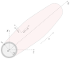

<!-- Author: Dr. Denys Dutykh (Mathematics Department, Khalifa University of Science and Technology, Abu Dhabi, UAE) -->

# SerreCyl: dispersive long-wave models of pulsatile blood flow in viscoelastic vessels

<p align="center"></p>

The sketch of the manuscript: a cylindrical elastic vessel filled with an ideal fluid and deformed symmetrically about
its axis, with the axis x along the vessel and the cross-section in the plane Oyz, the radius r₀ of the vessel at rest
and the radius r_w of its wall, the axial velocity u(x, r, t), and a pulse travelling along the vessel at the speed c.

This repository holds the LaTeX source of the manuscript "Nonlinear dynamics of pulsatile blood flow in viscoelastic
vessels: a dispersive wave approach" by Rim El Cheikh, Alexei Cheviakov, Denys Dutykh and Dimitrios Mitsotakis,
submitted for publication, with the Maple worksheets and the Python scripts that support it. Starting from the
axisymmetric Euler equations of an ideal incompressible fluid in a viscoelastic (Kelvin–Voigt) vessel, the manuscript
derives a hierarchy of long-wave models: the fully nonlinear cylindrical Serre–Green–Naghdi equations, the cylindrical
Boussinesq equations in the weakly nonlinear regime, and the unidirectional Korteweg–de Vries and Benjamin–Bona–Mahony
equations. It studies their dispersion relations, their solitary waves and numerical solutions, their conservation laws
and point symmetries, and the modulational instability of periodic wave trains, and an appendix builds a Windkessel
(lumped) model from the Serre-type equations. The approach brings out the interplay between nonlinearity, dispersion
and the interaction of the fluid with the wall in large arteries. The equations are best read in the manuscript itself,
`SerreCyl.pdf` (73 pages).

## Building the manuscript

The `Makefile` drives the build:

```sh
make             # build SerreCyl.pdf, then remove the intermediate files
make build       # build SerreCyl.pdf and keep the intermediate files (faster reruns)
make latexmk     # the same build driven by latexmk
make view        # open the PDF
make clean       # remove the intermediate files, keep the PDF
make distclean   # remove the intermediate files and the PDF
```

A build runs pdflatex once, then bibtex and makeglossaries (for the list of acronyms), then pdflatex twice more to
resolve every reference, which by hand reads

```sh
pdflatex SerreCyl.tex
bibtex SerreCyl
makeglossaries SerreCyl
pdflatex SerreCyl.tex
pdflatex SerreCyl.tex
```

With TeX Live 2025, `make` builds the 73 pages in a few seconds.

## Symbolic checks

The analytical results are accompanied by Python scripts in `scripts/`, which verify the underlying algebra with SymPy
and draw the figure of the modulational instability. Each one is run from the root folder of the repository, for
example `python3 scripts/verify_dispersion.py`, and prints its checks; all nine run in under a second each.

| Script | What it checks or makes |
|---|---|
| `verify_consistency.py` | the expansion of the velocity potential solves the cylindrical Laplace equation up to a residual of order δ⁶, the core of the consistency of the Serre–Green–Naghdi equations with the axisymmetric Euler equations |
| `verify_dispersion.py` | the long-wave expansion of the exact (Bessel) dispersion relation of the linearised Euler equations agrees with that of the Korteweg–de Vries reduction; the frequencies are real without damping and decay with it |
| `verify_energy.py` | the energy balance of the Korteweg–de Vries–Burgers and Benjamin–Bona–Mahony reductions |
| `verify_soliton_decay.py` | the law of the slow decay of the amplitude of the solitary wave under the damping of the wall |
| `verify_lie_algebra.py` | the commutators of the point symmetries (the Galilei algebra) |
| `verify_reductions.py` | the travelling-wave and self-similar reductions of the Boussinesq system |
| `verify_poisson.py` | the Hamiltonian structure of the reductions, the mass as a Casimir and the variational characterisation of the solitary waves |
| `verify_hodograph.py` | the strict hyperbolicity of the dispersionless limit, which the hodograph transformation linearises |
| `mi_growth.py` | the modulational instability of the Korteweg–de Vries and Benjamin–Bona–Mahony reductions, and the figure `figs/mi_growth.pdf` |

## Contents

| Folder or file | Contents |
|---|---|
| `SerreCyl.tex`, `SerreCyl.pdf` | the source of the manuscript and the manuscript |
| `biblio02.bib` | the bibliography |
| `wiley-article.cls`, `rss.bst`, `vancouver-authoryear.bst` | the class of the journal template and its two bibliography styles: `rss.bst` goes with the class option `alpha-refs`, which `SerreCyl.tex` uses, and `vancouver-authoryear.bst` with `num-refs` |
| `Makefile` | the build of the PDF |
| `figs/` | the figures of the manuscript, with the Inkscape sources `sketch.svg`, `Axis.svg` and `Gen.svg` of its sketches |
| `scripts/` | the Python scripts of the symbolic checks |
| `maple/` | seven Maple worksheets: the point symmetries and conservation laws of the cylindrical Serre–Green–Naghdi and Boussinesq systems, computed with the package GeM, and exact and formal solutions of the Boussinesq system |
| `LICENSE.md` | the licence |

## Requirements

A TeX distribution with pdflatex, bibtex and makeglossaries (and latexmk for `make latexmk`); Python 3 with SymPy,
NumPy and Matplotlib for the scripts; Maple for the worksheets.

## How to cite

The manuscript is submitted for publication and has no public record yet. Until it appears, please cite this
repository:

R. El Cheikh, A. Cheviakov, D. Dutykh and D. Mitsotakis, SerreCyl: dispersive long-wave models of pulsatile blood flow in
viscoelastic vessels, version 1.0.0 (2026).

https://github.com/dutykh/SerreCyl

```bibtex
@software{ElCheikh_SerreCyl,
  author = {El Cheikh, Rim and Cheviakov, Alexei and Dutykh, Denys and Mitsotakis, Dimitrios},
  title = {{SerreCyl}: dispersive long-wave models of pulsatile blood flow in viscoelastic vessels},
  year = {2026},
  version = {1.0.0},
  url = {https://github.com/dutykh/SerreCyl},
  license = {LGPL-3.0-only}
}
```

The button "Cite this repository" in the right-hand column of this page gives the same reference, read from
`CITATION.cff`.

## Licence

GNU Lesser General Public License, version 3 (see `LICENSE.md`).

## Authors

Rim El Cheikh (Univ. Grenoble Alpes, Univ. Savoie Mont Blanc, CNRS, LAMA, Chambéry, France), Alexei Cheviakov
(Department of Mathematics and Statistics, University of Saskatchewan, Saskatoon, Canada), Denys Dutykh (Mathematics
Department, Khalifa University of Science and Technology, Abu Dhabi, UAE) and Dimitrios Mitsotakis (School of
Mathematics and Statistics, Victoria University of Wellington, New Zealand). Questions and corrections are welcome
through the issues of this repository.

https://www.denys-dutykh.com/
